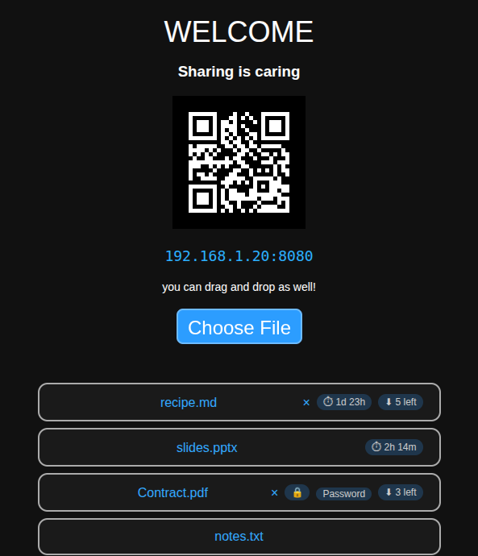
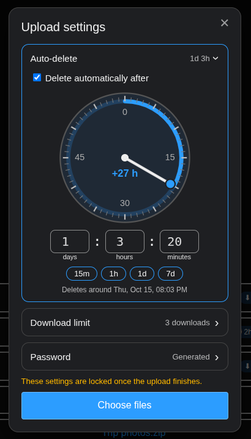
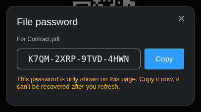
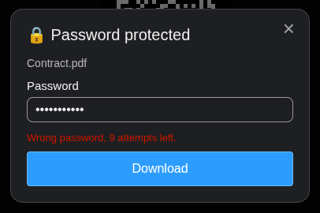
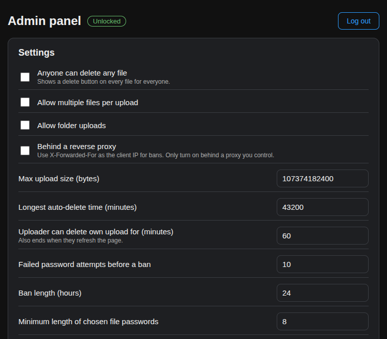
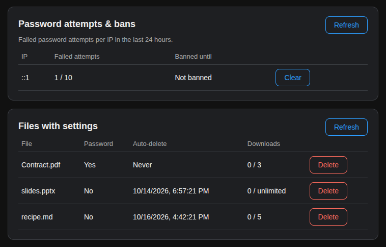

# Node.js-LAN-File-Sharing 
A small Node.js app for sharing files with devices on the same network. Run it on one machine, open the address (or scan the QR code) on another device, and drop files in. Especially useful when you are trying to get a file from a friend and their device has a single broken USB port.

## Features
- **Drag & drop or pick files** to upload, from any browser on the network. Large files work (tested with >2GB).
- **Fast**: your machine is the server, nothing goes through the internet. The page is lightweight (native JS + ).
- **QR code** of the server address on the page, for phones.
- **Live file list** that updates as files are added or removed.
- **Delete your own uploads** for up to an hour, until you refresh the page.
- **Auto-delete**: pick when an upload deletes itself, on a clock dial.
- **Download limits**: an upload deletes itself after a number of complete downloads.
- **Password protection**: files are encrypted on disk with a generated or chosen password.
- **Encrypted server data** under a secret key that only the admin holds, no database.
- **Admin panel** for settings and bans, only reachable on the server machine.
- **Optional HTTPS** with a self-signed or your own certificate.

## Screenshots
| The page, with file badges | Upload settings |
|---|---|
|  |  |

| Generated password, shown once | Downloading a protected file |
|---|---|
|  |  |

| Admin panel: settings | Admin panel: bans and files |
|---|---|
|  |  |

## Requirements
- Node.js 16 or newer

## Quick start
1. Clone (or download as zip) this project.
2. Open a terminal in the project folder.
3. Run `npm install`, then `node main.js`.
4. On the first run, choose a secret key (at least 12 characters) when asked. See [Secret key](#secret-key).
5. The terminal shows your LAN address and port (8080 by default). Open it on another device on the network, or scan the QR code on the page.
6. Drop files on the page, or click **Choose File**.

Uploaded files are saved in the `files` folder, and everything in that folder is listed on the page for download.

## Command line
```
node main.js [port] [files folder] [options]

  --data-dir <dir>          Where the encrypted server data is kept (default: ./data)
  --secret-file <file>      Read the secret key from this file (default: FSK in the project folder)
  --https                   Serve HTTPS with a self-signed certificate
  --https-cert <file>       Serve HTTPS with your own certificate (with --https-key)
  --https-key <file>
  --debug-print-passwords   Print file passwords in the terminal when uploaded (insecure)
  --help
```
The port can also be set with the `PORT` environment variable, e.g. `PORT=3030 node main.js`.

Upload and deletion settings are not command line options anymore, they are in the [admin panel](#admin-panel).

## Secret key
The server keeps its own data in one encrypted file, `data/state.enc`. This covers settings, auto-delete dates, download counts, which files are password protected, and failed password attempts. The secret key encrypts it. The server never stores the key, so without it that data can't be read.

At start the server looks for the key in this order:
1. The file given with `--secret-file`.
2. A file named `FSK` in the project folder.
3. Asks for it in the terminal. If there's no terminal, the server waits to be unlocked in the admin panel.

The server never creates or writes `FSK`. If you want it to start without typing the key, create the file yourself and keep it private:
```
printf '%s' 'your secret key' > FSK && chmod 600 FSK
```
`FSK` is in `.gitignore`.

Until the key is given, the server is **locked**: every page shows a "Server is locked" message, except the admin panel.

If the key is lost, the server data can't be recovered. Delete `data/state.enc` to start over. Files stay where they are, and password protected files can still be opened with their passwords, but auto-delete dates, download limits and bans are gone.

## Uploading
Clicking **Choose File** opens the upload settings first. Each setting is a collapsible section showing its current value:

- **Auto-delete**: drag the arm of the clock to set when the file deletes itself. One full turn is one hour, and going around adds hours. You can also type days : hours : minutes, or use the 15m / 1h / 1d / 7d shortcuts.
- **Download limit**: the file is deleted after this many *complete* downloads. A download that fails or is cancelled midway doesn't count. -1 means unlimited.
- **Password**: off, generate one, or choose your own. A generated password is shown once after the upload, with a copy button. Copy it then, because it's gone after you refresh the page.

These settings are locked once the upload finishes, nobody can change them afterwards. Then click **Choose files** to pick the files.

Drag & drop uploads skip the settings, they are plain uploads.

**Deleting your own uploads**: an × appears on files you uploaded from that page. It works for an hour (configurable), or until you refresh or close the page.

## Downloading
Click a file to download it. Files can show badges:
- ⏱ time left until auto-delete
- ⬇ complete downloads left
- 🔒 password protected

Clicking a 🔒 file asks for its password. After 10 wrong passwords (configurable), that device's IP can't try any password for 24 hours. The dialog shows how many attempts are left.

Files with a download limit or a password can't be resumed or downloaded in parts, so every download is a complete one.

## Admin panel
Open `http://localhost:<port>/admin` **on the server machine** (or `https://` with HTTPS). It doesn't answer requests from other devices. Log in with the secret key.

- **Settings**:
  - Allow everyone to delete any file.
  - Allow multi-file and folder uploads.
  - Max upload size.
  - Longest auto-delete time.
  - How long uploaders can delete their own uploads.
  - Ban threshold and length.
  - Minimum length of chosen passwords.
  - Running behind a reverse proxy.
- **Password attempts & bans**: see failed attempts per IP and clear bans.
- **Files with settings**: see auto-delete, download limits and protection per file, and delete files.
- **Security**:
  - HTTPS status and the certificate fingerprint.
  - A warning when `--debug-print-passwords` is on.
  - Change the secret key.

## Password protected files
A protected file is encrypted while it uploads, and its unencrypted contents never touch the disk. Only its password can decrypt it: the server doesn't keep the password or a hash of it, and neither the server owner nor anyone with access to the disk can open the file without it.

How it works:
- The password goes through scrypt, which unwraps a random per-file key.
- The file is encrypted in authenticated AES-256-GCM chunks, so tampering or a cut-short file is detected and that download fails.
- Several password checks never run at once, so guessing can't overload the server.
- A file that keeps getting wrong guesses from many IPs answers more and more slowly.

## HTTPS
Without HTTPS, everything (including file passwords) travels over the network unencrypted, readable by anyone who can see the network traffic.

- **`--https`** generates a self-signed certificate on first use and keeps it in `data/tls/`. It covers `localhost` and the machine's LAN addresses, and is regenerated if those change. Browsers will warn about it; the terminal and the admin panel show its SHA-256 fingerprint, so you can check it's really your server.
- **`--https-cert` and `--https-key`** use your own certificate instead.

## Where things are kept
| Path | What |
|---|---|
| `files/` (or the folder you pass) | Uploaded files. Password protected ones are encrypted. |
| `data/state.enc` | Encrypted server data, plus `state.enc.bak`, the previous version. |
| `data/tls/` | Self-signed HTTPS certificate and its private key. |
| `FSK` | The secret key, only if you create it. |

## Other pages
`/text_only/` is a basic upload page without the settings, for very old browsers.

## Security notes
- Use `--https` on networks you don't fully trust, otherwise file passwords can be read by others on the network.
- `--debug-print-passwords` prints file passwords in the terminal (and its scrollback/logs). Only use it for testing.
- IP bans slow down password guessing but don't stop someone who can change their IP. Long or generated passwords are what keep files safe.
- "Complete download" means the server sent the last byte. The browser can still discard it after that.
